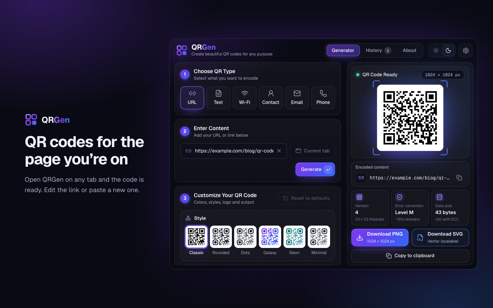
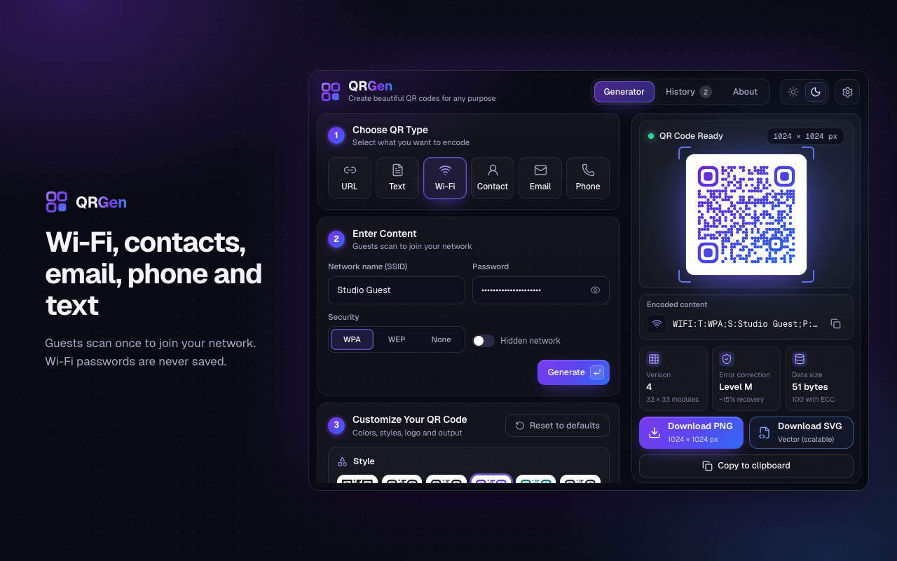
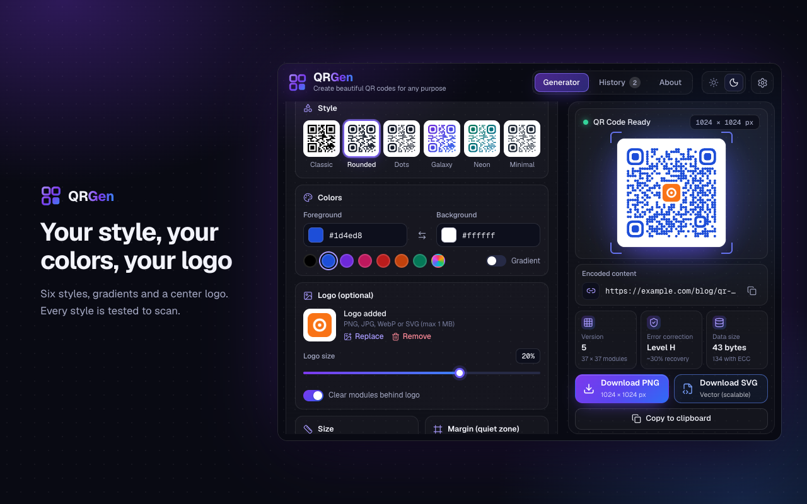
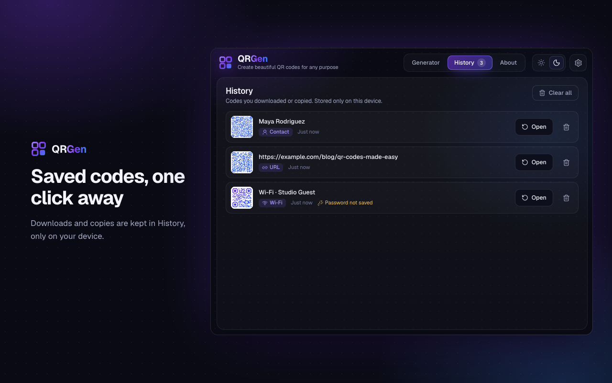
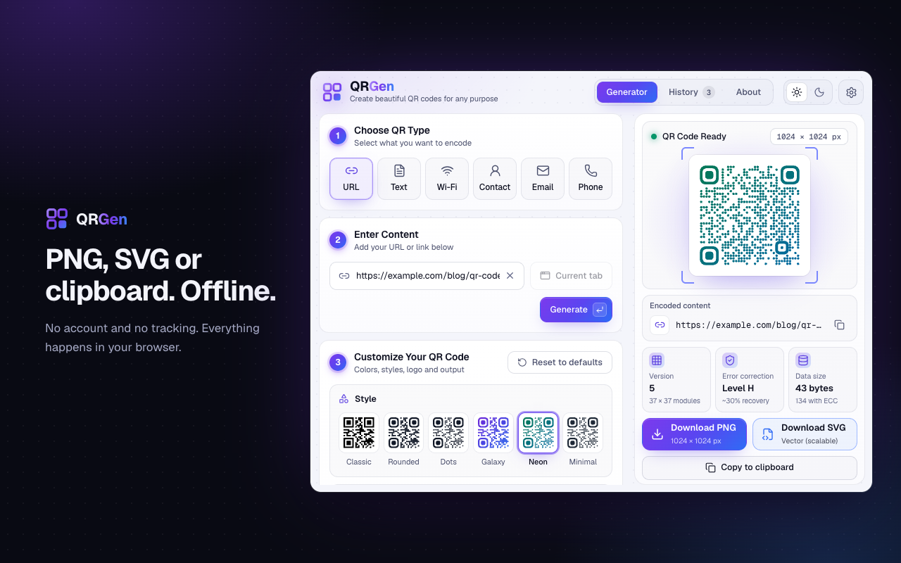

<div align="center">


# QRGen

**QR codes for the page you're on, or anything you type, right from the Chrome toolbar.**

Links · Wi-Fi · Contacts · Email · Phone · Text


</div>



## Features

- **One click for the current tab.** Open QRGen and the code for the page you're on is already there.
- **Six content types:** links, Wi-Fi networks, vCard contacts, email, phone numbers and plain text, each in the standard format phone cameras understand.
- **Styles that still scan.** Classic, Rounded, Dots, Galaxy, Neon and Minimal. Finder and alignment patterns stay solid, and colors with too little contrast are blocked.
- **Your branding.** Pick any colors or a gradient, and drop a logo in the center. Error correction switches to H automatically so the code keeps scanning.
- **Export:** PNG from 256 to 2048 px, SVG, or copy the image to the clipboard. Files are named after what they contain.
- **History** of codes you download or copy, kept on your device. Wi-Fi passwords are never saved.
- **Private.** No account, no analytics, no network requests.

| Wi-Fi and contacts | Styles and logos |
| --- | --- |
|  |  |
| **History** | **Light theme** |
|  |  |

## Install

> [!NOTE]
> QRGen isn't on the Chrome Web Store yet. Until it is, you can build it and load it yourself in about two minutes.

You need [Node.js](https://nodejs.org) 22.12 or newer.

```bash
git clone https://github.com/me-adityaraj8/qrgen.git
cd qrgen
npm install
npm run build
```

Then load it into Chrome:

1. Open `chrome://extensions`.
2. Turn on **Developer mode** (top right).
3. Click **Load unpacked** and choose the `dist` folder.
4. Pin QRGen from the puzzle-piece menu.

Other Chromium browsers such as Edge and Brave have the same **Load unpacked** option on their extensions page.

> [!TIP]
> `npm install` also downloads a copy of Chrome for the end-to-end tests (about 150 MB). If you only want to build, run `PUPPETEER_SKIP_DOWNLOAD=true npm install` instead.

## Usage

| To | Do this |
| --- | --- |
| Get a code for the current page | Click the toolbar icon, or press <kbd>Alt</kbd>+<kbd>Shift</kbd>+<kbd>Q</kbd> (<kbd>⌥</kbd><kbd>⇧</kbd><kbd>Q</kbd> on macOS) |
| Encode something else | Pick a type, fill in the form, then press <kbd>Enter</kbd> or **Generate** (<kbd>⌘</kbd>/<kbd>Ctrl</kbd>+<kbd>Enter</kbd> in multi-line fields) |
| Change the look | Use **Customize**: style, colors, logo, size, margin and error correction |
| Save it | **Download PNG**, **Download SVG** or **Copy to clipboard** |
| Reopen an earlier code | Open the **History** tab and click **Open** |
| Turn off history or change the shortcut | Open the ⚙ menu in the top right |

If you edit the content and download without pressing Generate, QRGen generates the latest version first, so the file always matches what you typed.

## Privacy

Everything happens inside the extension. QRGen never sends anything over the network, and it doesn't use analytics or ads.

| Permission | Used for |
| --- | --- |
| `activeTab` | Reading the URL of the tab you open QRGen on, and only then |
| `storage` | Your settings, logo and history, kept on your device |
| `downloads` | Saving the PNG or SVG files you ask for |

The full details are in [PRIVACY.md](PRIVACY.md).

## Development

```bash
npm run dev          # popup at http://localhost:5175 with hot reload
npm run build:watch  # rebuild dist/ on every change (reload the extension in chrome://extensions)
npm run check        # lint, typecheck, unit tests and end-to-end tests
```

`npm run dev` runs the popup as a normal web page and fakes the Chrome extension APIs. Add `?tab=https://example.com` to the URL to pretend you're on a different tab. For behavior that needs real Chrome, such as reading the active tab, downloads or the popup's size, use `npm run build:watch` and load `dist/`.

| Script | What it does |
| --- | --- |
| `npm run build` | Typecheck and build the extension into `dist/` |
| `npm test` | Unit and integration tests (Vitest) |
| `npm run test:e2e` | Build, then run the end-to-end suite in Chrome for Testing. Add `HEADFUL=1` to watch it. |
| `npm run lint` / `npm run typecheck` | ESLint / TypeScript |
| `npm run package` | Zip `dist/` into `release/` for the Chrome Web Store |
| `npm run store-assets` | Re-render the store screenshots and promo tile into `store/` |
| `npm run icons` | Re-render `public/icons/` from `assets/icon.svg` |

### How it works

1. **Content → payload.** [`src/lib/payload.ts`](src/lib/payload.ts) validates each form and builds the standard string for its type (`WIFI:…`, vCard, `mailto:`, `tel:`).
2. **Payload → matrix.** The [`qrcode`](https://www.npmjs.com/package/qrcode) library picks the QR version and mask pattern automatically.
3. **Matrix → image.** [`src/lib/render.ts`](src/lib/render.ts) turns the matrix into one drawing spec. The preview, the SVG export and the PNG export (whole-pixel modules) are all drawn from that same spec, so a download always matches the preview.

### Testing

Tests use two independent QR decoders, [jsQR](https://github.com/cozmo/jsQR) and [ZXing](https://github.com/Sec-ant/zxing-wasm), to read back what QRGen draws:

- **Unit tests** decode every style, gradient, logo size, margin, export size and content type.
- **End-to-end tests** install the built extension in Chrome for Testing and open the popup the way a real click on the toolbar button does. They check the real downloads, the copied clipboard image and what Chrome renders on screen. They also check that the popup makes no network requests and logs no errors.

<details>
<summary><strong>Project structure</strong></summary>

```
src/
├── manifest.ts      Manifest V3, generated into dist/manifest.json
├── popup/           App shell, styles and fonts
├── views/           Generator, History and About
├── components/      UI pieces (forms, preview, customize panels)
├── hooks/           State: generator, settings, theme, storage
├── lib/             Payloads, QR building, rendering, export, history
└── dev/             Fake Chrome APIs for `npm run dev`
tests/
├── unit/            Decoder round-trip tests
└── e2e/             Puppeteer tests and the store-asset generator
store/               Web Store screenshots, promo tile and listing text
```

</details>

<details>
<summary><strong>Debugging tips</strong></summary>

- **Inspect the popup:** right-click the toolbar icon and choose **Inspect popup**. The popup stays open while DevTools is open.
- **After rebuilding:** click the reload arrow on QRGen's card in `chrome://extensions`.
- **Stored data:** run `await chrome.storage.local.get()` in the popup console. The keys are `qrSettings`, `qrLogo`, `qrHistory` and `qrPrefs`.
- **Failed downloads:** `chrome://downloads` shows why a download was interrupted.
- **E2E artifacts:** each run saves its downloads and screenshots in `.e2e-artifacts/`.

</details>

## Publishing

1. Bump `version` in `package.json`.
2. Run `npm run package`.
3. Upload `release/qr-code-generator-<version>.zip` in the [Chrome Web Store Developer Dashboard](https://chrome.google.com/webstore/devconsole).

Everything the dashboard asks for is in [`store/LISTING.md`](store/LISTING.md): the description, screenshots, permission justifications and privacy answers.

## Contributing

Issues and pull requests are welcome. Before you open a PR:

- Run `npm run check` and make sure it passes.
- Keep the permissions as they are. Adding one means updating [PRIVACY.md](PRIVACY.md) and the store listing.
- Keep QRGen offline. Anything that sends data over the network breaks the privacy promise.

## Credits

Built with [React](https://react.dev), [Vite](https://vite.dev) and [`qrcode`](https://github.com/soldair/node-qrcode). Icons by [Lucide](https://lucide.dev), and the typeface is [Geist](https://vercel.com/font). Tests use [Vitest](https://vitest.dev), [Puppeteer](https://pptr.dev), [jsQR](https://github.com/cozmo/jsQR), [ZXing](https://github.com/Sec-ant/zxing-wasm) and [resvg](https://github.com/yisibl/resvg-js).
