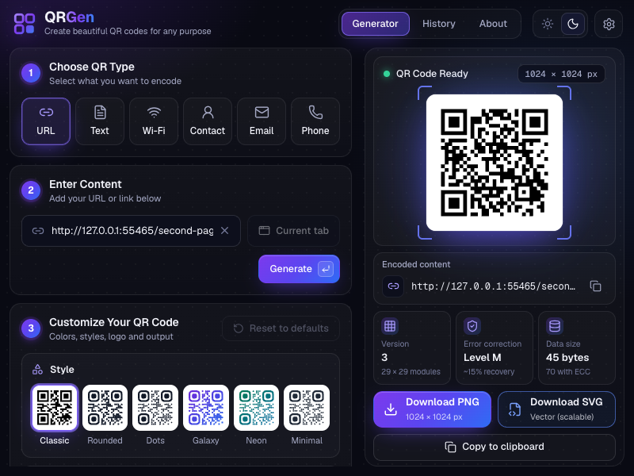
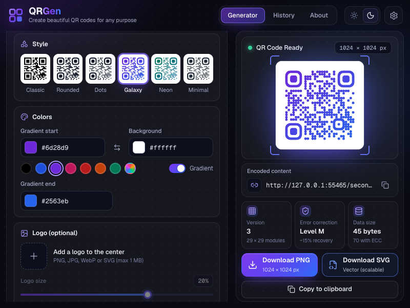
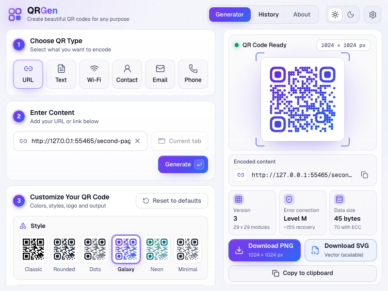

# QRGen: QR Code Generator for Chrome

Create QR codes for the page you're on, or for any link, text, Wi-Fi network, contact, email address or phone number, right from the toolbar. Pick a style, colors and an optional logo, then download a PNG or SVG or copy the image. Everything runs locally in the extension. There's no account, no backend and no network requests.

| Generator (dark) | Customization | Light theme |
| --- | --- | --- |
|  |  |  |

## Features

- **Six content types**, each encoded in its standard format:

  | Type | Payload |
  | --- | --- |
  | URL | The canonical link |
  | Text | Plain UTF-8 text |
  | Wi-Fi | `WIFI:T:WPA;S:…;P:…;;` with WPA, WEP or open networks and a hidden-network option |
  | Contact | vCard 3.0 |
  | Email | `mailto:` with subject and body |
  | Phone | `tel:` |

  Every form validates as you'd expect, and errors are shown on the field they belong to.
- **Current tab, instantly.** Opening the popup reads the active tab's URL and generates its code. Use current tab brings it back after edits.
- **Styles that still scan.** Classic, Rounded, Dots, Galaxy (gradient), Neon (gradient) and Minimal. Finder and alignment patterns are always drawn solid, so styled codes keep the proportions scanners rely on. Every style is decode-tested.
- **Colors:** foreground/background pickers and hex fields, swap, a row of swatches, and an optional two-color gradient. Downloads are blocked below 3:1 contrast, and every gradient stop is checked.
- **Center logo:** upload a PNG, JPG, WebP or SVG (up to 1 MB). You can set its size (10–25%) and choose whether to clear the modules behind it. Adding a logo switches error correction to H so the code keeps scanning; you're warned if you lower it.
- **Size and quiet zone:** export at 256, 512, 1024 or 2048 px. The margin slider runs from 4 to 16 modules; it never goes below the 4-module minimum the QR standard requires.
- **Error correction** L / M / Q / H, with the QR version and mask chosen automatically by [`qrcode`](https://www.npmjs.com/package/qrcode).
- **Live preview with honest stats:** status (*QR Code Ready*, *Encoding*, *Out of date*, *Can't generate*, *Low contrast*), version and module count, error-correction level, payload bytes, and total codewords including ECC.
- **Export:**
  - PNG (integer-pixel modules at the exact size), SVG (vector) or copy the image to the clipboard.
  - Files are named after their content, e.g. `qr-example.com-pricing.png` or `qr-wifi-studio-5g.png`.
  - The preview and the file come from the same geometry. Downloading an edited form regenerates it first, so they always match.
  - Failed or canceled downloads are reported.
- **History:** codes you download or copy are kept on this device. Open restores the content and style; you can also delete entries or clear all. Wi-Fi passwords are never saved: the stored payload leaves them out, and the password is masked in the preview's "Encoded content" line. History can be turned off in Settings.
- **Keyboard first:**
  - **Alt+Shift+Q** (**⌥⇧Q** on macOS) opens the popup.
  - **Enter** generates, and **⌘/Ctrl+Enter** generates from multi-line fields.
  - Arrow keys move between tabs, types, styles and levels.
  - Labels, focus rings, `aria-invalid`/`role="alert"` and live regions are all in place.
- **Dark and light themes** from the header toggle. The choice is remembered.

## Install in Chrome (Load unpacked)

1. Build it (see below), or use an existing `dist/` folder.
2. Open **`chrome://extensions`** in Chrome.
3. Turn on **Developer mode** (toggle, top right).
4. Click **Load unpacked** and select the **`qr-code-extension/dist`** folder (the one that contains `manifest.json`).
5. Pin it: click the puzzle-piece icon in the toolbar, then the pin next to **QRGen: QR Code Generator**.
6. Open any web page and click the icon, or press **Alt+Shift+Q** (**⌥⇧Q** on macOS).

If the shortcut is already taken, Chrome leaves it unassigned. Set one at **`chrome://extensions/shortcuts`**, or use **Settings → Keyboard shortcut** in the popup.

## Development

Requires **Node.js 22.12+** (tested with Node 24) and npm.

```bash
npm install          # also downloads Chrome for Testing for the E2E tests (cached in ~/.cache/puppeteer)
npm run build        # type-checks, then builds the extension into dist/
```

| Script | What it does |
| --- | --- |
| `npm run dev` | Serves the popup at http://localhost:5175/popup.html with hot reload and simulated extension APIs. |
| `npm run build` | Type-check (`tsc -b`) and production build into `dist/`. |
| `npm run build:watch` | Rebuild `dist/` on every change; reload the extension in Chrome to pick it up. |
| `npm run lint` | ESLint (TypeScript + React Hooks rules). |
| `npm run typecheck` | TypeScript only. |
| `npm test` | Unit and integration tests (Vitest + Testing Library + independent QR decoders). |
| `npm run test:e2e` | Builds, then runs the end-to-end suite in Chrome for Testing. Set `HEADFUL=1` to watch it. |
| `npm run check` | Lint, typecheck, unit tests and E2E tests: everything CI should run. |
| `npm run package` | Builds and writes `release/qr-code-generator-<version>.zip` for the Chrome Web Store. |
| `npm run icons` | Re-renders `public/icons/*.png` from `assets/icon.svg`. |

### UI development without reloading the extension

`npm run dev` opens the popup as a normal page. A development-only shim (`src/dev/chromeShim.ts`, stripped from production builds) fakes the extension APIs:

- `?tab=https://example.com/page` simulates the active tab's URL. Use `?tab=` for a tab without a readable URL.
- Storage goes to `localStorage`, and downloads use a regular `<a download>`.

For real Chrome behavior (activeTab, `chrome.downloads`, popup sizing), use `npm run build:watch` and load `dist/` unpacked.

### Debugging

- **Popup DevTools:** right-click the toolbar icon, then **Inspect popup**. The popup stays open while DevTools is attached.
- **After rebuilding:** click the reload arrow on the extension's card in `chrome://extensions`. Install or manifest errors appear there as an **Errors** button.
- **Stored data:** in the popup console, run `await chrome.storage.local.get()` to see the keys `qrSettings`, `qrLogo`, `qrHistory` and `qrPrefs`. **Settings → Reset all settings** and **Clear history** reset them. The theme lives in the popup's `localStorage` under `qr-theme`.
- **Downloads:** check `chrome://downloads` for interrupted items and their reasons.
- **E2E failures:** run `HEADFUL=1 npm run test:e2e` to watch the browser. Downloads and screenshots from each run are in `.e2e-artifacts/`.

## Testing

`npm run check` runs **120 unit/integration tests** and **32 end-to-end tests**, all passing.

**Unit and integration** (`src/**/*.test.ts(x)`, `tests/unit/`)

- **Round-trip decoding** with two independent decoders, **jsQR** and **ZXing** (C++ via WebAssembly). The SVG export and the PNG geometry (rasterized by resvg) are decoded for:
  - every style, with and without a gradient;
  - logos at 10, 20 and 25% in every style;
  - margins of 4, 8 and 16 modules, and all export sizes;
  - every error-correction level, special characters, IDN and a near-capacity URL;
  - all six content types, decoding to their exact payloads.
- **Payload encoders:** validation, Wi-Fi/vCard escaping, phone normalization, WEP key lengths, and capacity limits per level.
- **Settings and history:** settings sanitizing (the margin can't drop below 4), filenames for every type, contrast of every palette and swatch, history de-duplication and limits, and proof that Wi-Fi passwords never reach storage.
- **Popup integration** against a mocked `chrome` API:
  - all six types and their errors, stale preview and regeneration, current-tab handling, and the too-long state;
  - styles, swatches, gradient, error correction, size and margin, the logo (including the switch to level H), contrast blocking, reset and persistence;
  - SVG/PNG export, downloading the latest input, failure toasts, image and text copy;
  - history open/delete, Wi-Fi password re-entry, history off;
  - theme, tab keyboard navigation and the settings menu.

**End to end** (`tests/e2e/`): the production `dist/` is installed into **Chrome for Testing** with Puppeteer, and the popup is opened by simulating a **click on the toolbar button** (the real `activeTab` grant). The suite checks:

- the manifest, minimal permissions and that only bundled scripts load;
- the popup fills exactly 800 × 600 with nothing clipped;
- the fonts load;
- current-tab detection, with the preview markup *and Chrome's on-screen rendering* both decoding to the tab URL;
- URL validation, and every content type decoding to its exact payload;
- every style decoding both as SVG and on screen;
- gradient **PNG and SVG downloads** with a custom margin and size, checked for dimensions, quiet zone and filenames and decoded;
- logo exports: the logo pixel is present, error correction is H, and both files decode;
- **copy to clipboard**: the copied image is read back and decoded;
- downloads using unsaved input, unique repeat filenames, a 2,300+ character URL at 2048 px, the too-long error and the contrast block;
- history restore and clearing, with no Wi-Fi password in storage;
- settings and theme surviving close and reopen;
- `about:blank` and `chrome://` tabs;
- **no network requests** and **no console errors**.

## Permissions and privacy

| Permission | Why |
| --- | --- |
| `activeTab` | Read the URL of the tab you opened the popup on. It's granted only when you click the icon or use the shortcut, so there is no "read your browsing history" warning. |
| `storage` | Keep your settings, logo and history on this device (`chrome.storage.local`). |
| `downloads` | Save PNG/SVG files with a proper name and report failures. Chrome shows this as "Manage your downloads". |

No host permissions, content scripts, background worker, remote code, analytics or network access. History stays on the device, can be turned off, and never contains Wi-Fi passwords. The extension doesn't judge whether a destination is safe to visit; it only encodes what you enter.

Browser pages (new tab, `chrome://` pages, the Chrome Web Store) don't expose their URL to extensions. On those the popup asks you to type one.

## Design notes

- **Popup size:** the popup uses Chrome's maximum size, 800 × 600. The left column (type, content, customize) scrolls; the preview, stats and export buttons stay fixed on the right.
- **Visual language:** midnight surfaces with a subtle dot texture, numbered step cards, and one violet-to-blue gradient reserved for primary actions and selected states. Type is Geist and Geist Mono, bundled (Latin subset, about 52 KB). Icons are from Lucide.
- **Motion:** a new code is revealed once with a scan line and the viewfinder brackets lock on. Colors cross-fade and selection indicators slide. All of it is turned off under `prefers-reduced-motion`. QR modules never move once shown.
- **One geometry builder:** `src/lib/render.ts` produces a single spec used by the inline preview, the SVG export (module units) and the PNG export (integer pixels, logo drawn on the canvas).

## Packaging for distribution

1. Bump `version` in `package.json`. The manifest version is generated from it.
2. Run `npm run package`. This creates `release/qr-code-generator-<version>.zip` with `manifest.json` at the archive root and prints its SHA-256.
3. **Chrome Web Store:** upload the zip in the [Developer Dashboard](https://chrome.google.com/webstore/devconsole). Use the permission justifications above. For the privacy questionnaire: no user data is collected or transmitted, and local history can be disabled.
4. **Self-hosted `.crx` (optional):** in `chrome://extensions`, click **Pack extension**, choose `dist/`, and keep the generated `.pem` key safe and out of git. You need the same key for every update. Chrome on Windows and macOS only installs `.crx` files from the Web Store or via enterprise policy.

## Project structure

```
qr-code-extension/
├── popup.html                 # Popup entry (Vite input)
├── src/
│   ├── manifest.ts            # Typed Manifest V3, emitted as dist/manifest.json
│   ├── types.ts               # Shared TypeScript types
│   ├── popup/                 # App.tsx (shell, tabs, toasts), main.tsx, styles.css, fonts.css
│   ├── views/                 # GeneratorView, HistoryView, AboutView
│   ├── components/            # Header, SettingsMenu, TypePicker, ContentForm, CustomizeCard,
│   │                          # StylePicker, ColorPanel, LogoPanel, PreviewPanel, QrSvg, Toast, ui
│   ├── hooks/                 # useGenerator (commit/export logic), useSettings, useStoredState,
│   │                          # useActiveTab, useTheme, useShortcut, useReducedMotion
│   ├── lib/                   # payload (types → standard formats), qr, render (styled geometry),
│   │                          # export (PNG/SVG/clipboard), download, history, logo, url, color,
│   │                          # filename, settings, clipboard, chrome wrappers
│   ├── vendor/qrcodeInternals.ts  # Typed access to qrcode's codeword/alignment helpers
│   ├── dev/chromeShim.ts      # Dev-server-only fake extension APIs
│   └── test/                  # Test setup and chrome API mock
├── tests/
│   ├── decode.ts              # jsQR + ZXing + resvg helpers
│   ├── unit/                  # Decoder round-trip tests
│   └── e2e/                   # Puppeteer harness and Chrome tests
├── public/icons/              # Toolbar and store icons (generated from assets/icon.svg)
├── scripts/                   # generate-icons.mjs, package.mjs
└── dist/                      # Build output (load this folder in Chrome)
```

## Tech stack

React 19, TypeScript 6, Vite 8, `qrcode` 1.5, `lucide-react`, Geist fonts (`@fontsource-variable`, OFL-1.1), Vitest 5 with Testing Library, and Puppeteer 25 with Chrome for Testing. jsQR, ZXing-wasm and resvg are used for test verification only. Styling is plain CSS with custom-property design tokens; no CSS framework is needed.
